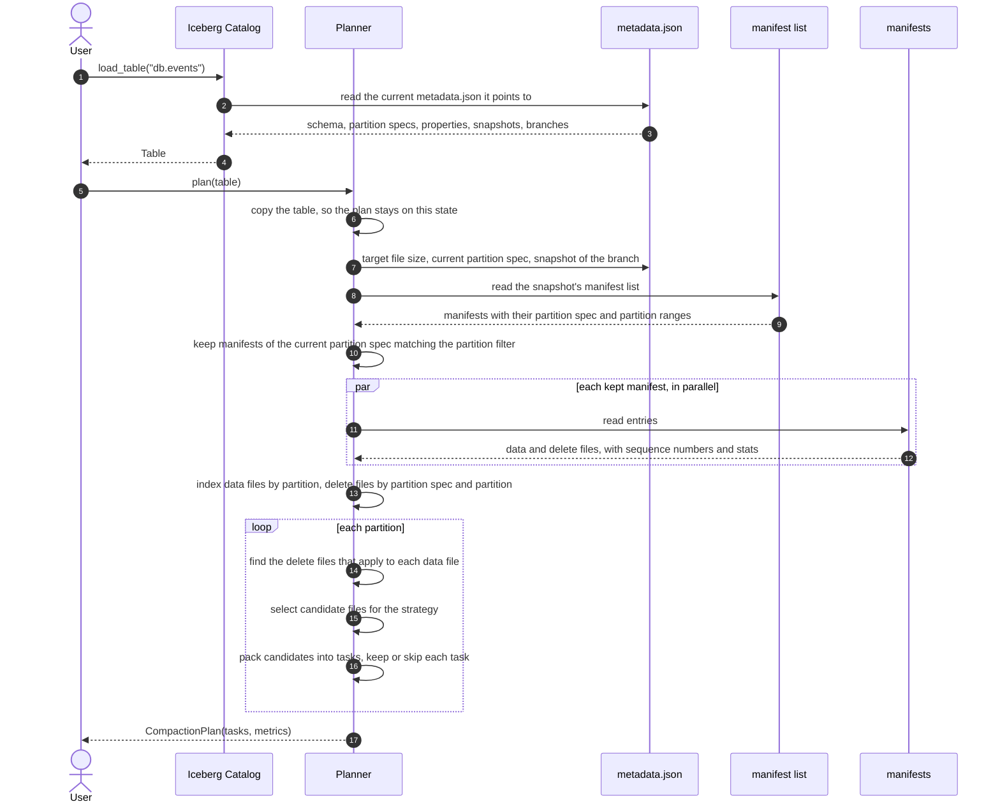
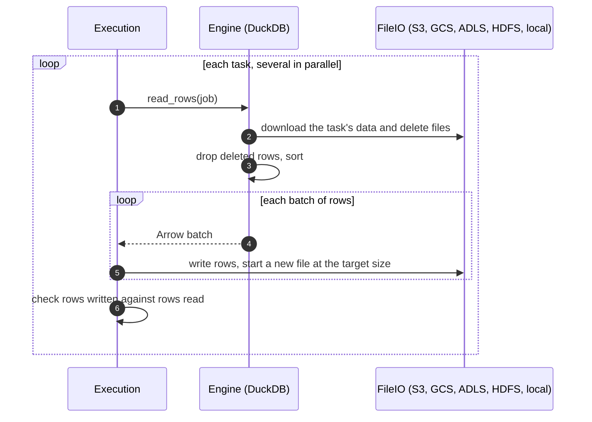

# Goal

Rewrite data files of an Iceberg table into files "near" a target size, partition by partition
- merge small files, split the too big ones
- apply delete files (position + equality), re-written files don't carry deleted rows anymore
- sort rows using the table's sort order

The switch is atomic, one snapshot replace old files with the new ones

# Usage

```bash
pip install "iceberg-compaction[duckdb]"   # duckdb engine is an optional extra
```

```python
from iceberg_compaction import Execution, Planner, Strategy, compact
from iceberg_compaction.engines.duckdb_engine import DuckDBEngine

with DuckDBEngine(memory_limit="8GB") as engine:
    result = compact(table, Planner(strategy=Strategy.AUTO, target_file_size_mib=512), Execution(engine))
print(result.snapshot_id, result.plan_metrics, result.execution_metrics)
```

# High Level Architecture

1. **Plan**: read table metadata (manifest list and manifests), never data files, and decide which files are rewritten together => `Planner(...).plan(table)`
2. **Execute**: stream rows of each task through an engine (DuckDB by default) and write new files near the target size => `Execution(engine).execute(plan)`
3. **Commit**: replace rewritten files with the new ones in one atomic snapshot => `Committer().commit(result)`

`compact()` runs the 3 steps, but you can call each step on its own aswell (for example to look at the plan before running it)

# Planner

The planner reads table metadata, never data files and returns a `CompactionPlan`, which is basically a list of `CompactionTask`
A task is a set of data files of one partition, plus the delete files that apply to them

```python
plan = Planner(strategy=Strategy.AUTO, target_file_size_mib=128).plan(table)
```

## How it plans



## How tasks are chosen

Planner works partition by partition in 3 steps: pick files to rewrite, group them into tasks, keep only tasks worth running

### First, delete files and sequence numbers

Iceberg can delete rows without rewriting data files, it writes a small **delete file** and readers apply it on the fly

- **equality delete**: "delete rows where `id = 1`" (streaming upserts, like Flink)
- **position delete**: "delete row 5 of `data-A.parquet`" (Spark `DELETE` / `UPDATE` / `MERGE`)

Compaction applies them for good, new files don't have deleted rows

Every commit gets a **sequence number** (1, 2, 3, etc) and each file keeps the number of the commit that wrote it
Rule is: **a delete only removes rows written before it**. Example, we rename Toto to Tutu:

```
seq 1  data-A.parquet      1 | Toto,  2 | Titi
seq 2  eq-delete.parquet   delete where id = 1
       data-B.parquet      1 | Tutu
```

The delete (seq 2) applies to `data-A` (seq 1) so Toto is gone, but not to `data-B` which is written in the same commit, so Tutu stays
Position deletes are a bit different: they point to an exact file, so they also apply to a file from their own commit

### Step 1: pick files

The **strategy** says which data files are worth rewriting

| Strategy | Picks a data file when |
|---|---|
| `FILE_SIZE` (default) | its size is off (too small, too big or both, see compaction mode) |
| `FILES_WITH_DELETES` | at least `min_delete_file_count` delete files apply to it |
| `AUTO` | one of the two |
| `FULL` | always (for example to apply a new sort order) |

The **compaction mode** says what "size is off" means, with a 512 MiB target:

| Compaction mode | Picks | Default limit |
|---|---|---|
| `MERGE` (default) | small files | under 512 MiB (`min_file_size_ratio` = 1.0) |
| `SPLIT` | too big files | over 921.6 MiB (`max_file_size_ratio` = 1.8) |
| `BOTH` | both | |

Files between the two limits are fine, we don't touch them
A picked file always comes with its delete files, so the rewrite drops deleted rows

### Step 2: group into tasks

Picked files of a partition make one **task** (unit of work, rewritten together)
With `max_task_size_gib` a big partition is split in several tasks

### Step 3: keep tasks worth running

Each task goes through these checks in order, first one that matches decides

1. strategy is `FULL` => **kept**
2. has delete files to apply => **kept**
3. has a too big file to split => **kept**
4. merging doesn't reduce the number of files => **skipped** (a lone small file is always skipped)
5. under `min_task_size_mib` or `min_task_file_count` => **skipped**
6. otherwise => **kept**, files get merged

"Reduce the number of files" means `ceil(task size / target) < number of files`, this estimate is stored on the task as `estimated_output_files`

### Example

Strategy `AUTO`, compaction mode `BOTH`, target 512 MiB, partitioned by day

| Partition | Data files | Result |
|---|---|---|
| `day=01` | 40 files of 10 MiB | kept: 1 file of 400 MiB |
| `day=02` | 1 file of 10 MiB | skipped: nothing to merge it with |
| `day=03` | 1 file of 600 MiB with a position delete | kept: delete gets applied |
| `day=04` | 2 files of 600 MiB | untouched: sizes are fine, no deletes |
| `day=05` | 1 file of 1.2 GiB | kept: split into 3 files |

### Limits

- files written with an older partition spec are left alone, their rows can belong to several current partitions
- a non Parquet file or a format v3 table stops the plan with an error

# Execution

`Execution` runs tasks of a plan and writes new data files. It doesn't touch the table, commit does that

```python
with DuckDBEngine(memory_limit="8GB") as engine:
    result = Execution(engine, max_concurrent_tasks=4).execute(plan)
```

## How a task is rewritten



The writer fills a file up to the target size and then starts the next one, that's how merge and split both work:
40 small files become 1, a 1.2 GiB file becomes 3. If something fails, files written so far are deleted

## Engines

The engine only produces rows: reads files, drops deleted rows, sorts. `Execution` writes files and deals with Iceberg
To add an engine, subclass `CompactionEngine` and implement `read_rows` and `close`

`DuckDBEngine` downloads files through the table's FileIO so it works with any storage pyiceberg supports
All tasks share one DuckDB database, `memory_limit` caps the whole run and DuckDB spills to disk above it
Local disk needed: around the size of the tasks running at the same time

# Commit

`Committer().commit(result)` replaces rewritten files with the new ones in one snapshot, on the planned branch

- **Conflicts**: commit is checked against every change made since the plan. If a writer removed a planned file or
  added a delete on one, commit fails with `ValidationException` (otherwise deleted rows would come back)
  Concurrent appends also fail by default, set `write.delete.isolation-level=snapshot` on the table to allow them
- **Failure**: new files are deleted and the table doesn't change. Except if the outcome is unknown
  (`CommitStateUnknownException`), then files are kept cauz the commit may have landed
- **Delete files** stay in table metadata but they don't apply anymore to rewritten rows
