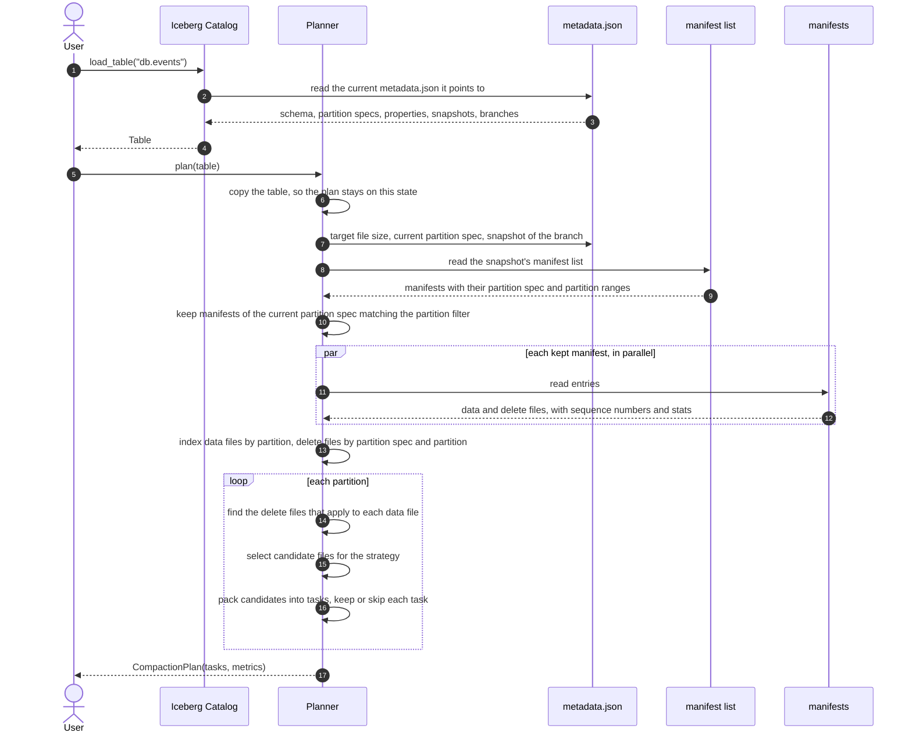

# Goal

The goal of this tool is to rewrite data files of an Iceberg Table, into "near" a target size.
- Takes into consideration Hive Partitions
- Merge Small files
- Apply delete files: position + equality, re-written files will not carry deleted rows
- sort rows using the table's sort order

# High Level Architecture (still working on it)

- Plan the compaction by reading Catalog's manifests
- Rewrite all files (We need to be able to easily switch the engine used to re-write files)
- Commit all rewritten files into one atomic snapshot

# Planner

The planner reads table metadata, never data files and returns a `CompactionPlan`, which is basically a list of `CompactionTask`
A task is a set of data files of one partition, plus the delete files that apply to them

```python
plan = Planner(strategy=Strategy.AUTO, target_file_size_mib=128).plan(table)
```

## How it plans



# Rewriter
TODO